# Eduardo Skills

Eduardo Skills is a collection of GitHub Copilot skills for software-engineering workflows and personal productivity. It is shaped around my own way of working. The initial idea was inspired by Matt Pocock's skills, but the workflows here have been independently designed and rewritten.

## Install

GitHub Copilot CLI:

```bash
copilot plugin install eduardoascunha/skills
```

In VS Code, run **Chat: Install Plugin From Source** and enter:

```text
https://github.com/eduardoascunha/skills
```

## Spec-Driven Workflows

### Workflow 1: Simple changes


Use this for a small, self-contained change. Clarify the idea, approve the spec, implement it, then review the result.

### Workflow 2: Complex changes



Use this for a larger change. Split the approved spec into tasks, then choose one task per `/implement-task <id>` call. A clean review marks that task done. Continue with another task until finish.

## Skills

The skills are grouped into [`engineering`](./skills/engineering/) workflows and [`productivity`](./skills/productivity/) tools.

`U` means user-invoked. `M` means model-invoked.

### Engineering

- **[archive](./skills/engineering/archive/SKILL.md)**: Archive the current workflow using a name derived from its spec. `U`
- **[grill-me](./skills/engineering/grill-me/SKILL.md)**: Clarify an idea through questions. `U`
- **[to-spec](./skills/engineering/to-spec/SKILL.md)**: Turn an idea into an approved spec. `U`
- **[to-task](./skills/engineering/to-task/SKILL.md)**: Split a spec into ordered tasks. `U`
- **[implement](./skills/engineering/implement/SKILL.md)**: Implement an approved spec. `U`
- **[implement-task](./skills/engineering/implement-task/SKILL.md)**: Implement one task. `U`
- **[code-review](./skills/engineering/code-review/SKILL.md)**: Review a spec implementation. `M`
- **[code-review-task](./skills/engineering/code-review-task/SKILL.md)**: Review one task implementation. `M`

### Productivity

- **[answer-message](./skills/productivity/answer-message/SKILL.md)**: Create an AI-style reply to a message or rewrite. `U`
- **[improve-text](./skills/productivity/improve-text/SKILL.md)**: Improve English or Portuguese text. `U`
- **[learn-language](./skills/productivity/learn-language/SKILL.md)**: Practise a language through conversation. `U`
- **[research](./skills/productivity/research/SKILL.md)**: Research a topic using primary sources. `U`
- **[unslop-code](./skills/productivity/unslop-code/SKILL.md)**: Simplify code without unnecessary complexity. `M`
- **[unslop-prose](./skills/productivity/unslop-prose/SKILL.md)**: Simplify prose while preserving its meaning and register. `M`